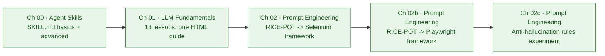
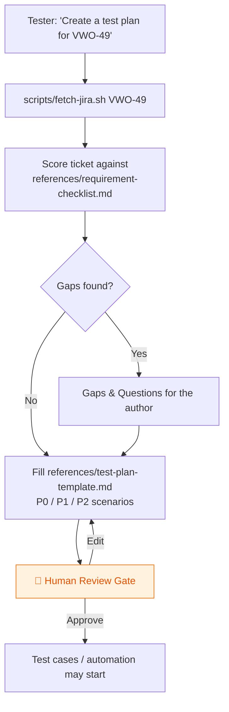
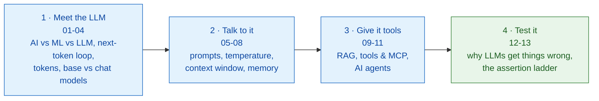
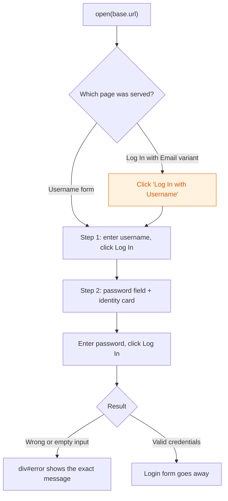
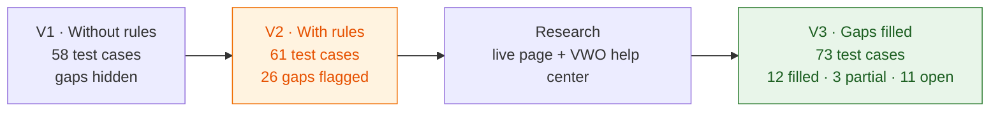

# 🤖 AI Tester Blueprint 5x

Hands-on course material from **The Testing Academy** for testers moving into AI: build Agent Skills that do real QA work, then learn how the LLMs behind them actually behave, so you can test them.

---

## 📑 Table of Contents

- [Roadmap](#-roadmap)
- [Chapters at a glance](#-chapters-at-a-glance)
- [Project structure](#-project-structure)
- [Getting started](#-getting-started)
- [Chapters](#-chapters)
  - [00 · Agent Skill Basics](#00--agent-skill-basics)
  - [01 · LLM Fundamentals from Scratch](#01--llm-fundamentals-from-scratch)
  - [02 · Prompt Engineering: RICE-POT to a Selenium Framework](#02--prompt-engineering-rice-pot-to-a-selenium-framework)
  - [02b · Prompt Engineering: RICE-POT to a Playwright Framework](#02b--prompt-engineering-rice-pot-to-a-playwright-framework)
  - [02c · Prompt Engineering: Anti-Hallucination Rules Experiment](#02c--prompt-engineering-anti-hallucination-rules-experiment)
- [Learnings](#-learnings)

---

## 🗺️ Roadmap



---

## 📚 Chapters at a glance

| # | Chapter | What you build or learn | Format | Status |
|:-:|:--------|:------------------------|:-------|:------:|
| 00 | [Agent Skill Basics](Chapter_00_SKILL_Basics/) | A basic and an advanced test-plan skill (Jira ticket -> reviewed test plan) | `SKILL.md` + references + scripts | ✅ |
| 01 | [LLM Fundamentals from Scratch](Chapter_01_LLM_Basics/) | 13 plain-words lessons: tokens, temperature, context, RAG, MCP, agents, testing LLM output | Single-file HTML guide | ✅ |
| 02 | [Prompt Engineering](Chapter_02_Prompt_Engineering/RICE_POT/) | A RICE-POT prompt turned into a Selenium + Java framework for the Salesforce login page, run headless and headed | Maven + TestNG + Allure | ✅ |
| 02b | [Prompt Engineering · Playwright](Chapter_02_Prompt_Engineering/RICE_POT/PlaywrightFramework/) | The same RICE-POT approach turned into a Playwright + TypeScript framework for the VWO (Wingify) login page | Playwright Test + Allure | ✅ |
| 02c | [Prompt Engineering · Anti-hallucination](Chapter_02_Prompt_Engineering/TestCaseEvaluation_whenrulesApplied.md) | The same test-case prompt run without and with anti-hallucination rules, then every flagged gap researched: 58 → 61 → 73 VWO login test cases | Excel workbooks + evaluation write-up | ✅ |

---

## 🌳 Project structure

```
AITesterBlueprint5x/
├── Chapter_00_SKILL_Basics/
│   ├── 00_basics_skills/
│   │   ├── testplan-creator-skill/          # basic skill: template inline in SKILL.md
│   │   ├── testcase-creator-skill/          # placeholder (empty SKILL.md)
│   │   └── apitestcase-response-validator-skill/   # placeholder (empty SKILL.md)
│   ├── 01_advance-skills/
│   │   └── testplan-creator-skill_a/        # advanced skill: Jira -> gap analysis -> plan
│   │       ├── SKILL.md
│   │       ├── references/                  # requirement-checklist.md, test-plan-template.md
│   │       ├── scripts/fetch-jira.sh        # curl + jq Jira REST v3 fetch
│   │       ├── misc/                        # company logo, company details
│   │       └── output/VWO-49-test-plan.pdf  # sample output
│   └── resources/VWO-49.doc                 # source ticket
├── Chapter_01_LLM_Basics/
│   └── LLM_Fundamentals.html                # 13-lesson guide, open in any browser
├── Chapter_02_Prompt_Engineering/
│   ├── TestCaseEvaluation_whenrulesApplied.md   # with vs without anti-hallucination rules, gap analysis
│   └── RICE_POT/
│       ├── REALPROMPT_RICE_POT.md           # the filled RICE-POT prompt behind the Selenium framework
│       ├── REALPROMPT_RICE_POT_Playwright.md  # the filled RICE-POT prompt behind the Playwright framework
│       ├── Template_RICE_POT/               # blank RICE-POT template + guardrail block
│       │   ├── Template.RICEPOT_Without_Antihallucination.md     # VWO test-case prompt, no rules
│       │   └── Template.RICEPOT_With_AntihallucinationRules.md   # same prompt + 6 anti-hallucination rules
│       ├── PlaywrightFramework/             # Playwright Test + TypeScript + Allure (Chromium)
│       │   ├── playwright.config.ts         # baseURL, retries, reporters, chromium project
│       │   ├── .env.example                 # VWO_BASE_URL, VWO_EMAIL, VWO_PASSWORD
│       │   ├── pages/                       # BasePage.ts, LoginPage.ts
│       │   ├── fixtures/baseFixture.ts      # injects loginPage + credentials
│       │   ├── test-data/login.json         # expected texts + data-driven invalid cases
│       │   └── tests/                       # login.valid.spec.ts, login.invalid.spec.ts
│       └── SeleniumFramework/               # Maven + TestNG + Selenium 4 + Allure
│           ├── pom.xml
│           ├── testng.xml                   # "Valid Login" and "Invalid Login" tests
│           └── src/
│               ├── main/java/com/atb5x/salesforce/
│               │   ├── pages/LoginPage.java         # PageFactory, XPath only, explicit waits
│               │   └── exceptions/FrameworkException.java
│               └── test/
│                   ├── java/com/atb5x/salesforce/
│                   │   ├── base/BaseTest.java       # config, one driver per test, failure evidence
│                   │   └── tests/                   # ValidLoginTest, InvalidLoginTest
│                   └── resources/                   # config.properties, allure.properties
├── learnings/                               # one-page approach notes per solved problem
├── output/                                  # generated test plans (HTML + PDF) and VWO test case workbooks (.xlsx)
└── .env                                     # Jira credentials, git-ignored
```

---

## 🚀 Getting started

```bash
git clone https://github.com/PramodDutta/AITesterBlueprint5x.git
cd AITesterBlueprint5x

# Chapter 01: no build step, just open the guide
open Chapter_01_LLM_Basics/LLM_Fundamentals.html

# Chapter 00: the advanced skill needs Jira credentials in .env (never commit it)
cat > .env <<'EOF'
JIRA_BASE_URL=https://yourco.atlassian.net
JIRA_EMAIL=you@yourco.com
JIRA_TOKEN=your-api-token
EOF

# Chapter 02: needs Java 17+, Maven and Chrome (Selenium Manager downloads the driver)
cd Chapter_02_Prompt_Engineering/RICE_POT/SeleniumFramework
mvn clean test

# Chapter 02b: needs Node.js 18+
cd ../PlaywrightFramework
npm install
npx playwright install chromium
npm test
```

---

## 📖 Chapters

### 00 · Agent Skill Basics

**Concept:** An Agent Skill is a folder with a `SKILL.md` file (YAML frontmatter plus instructions) that teaches an AI agent one repeatable QA job. Here, that job is turning a PRD or a Jira ticket into a test plan that follows your company's template.

**Why:** It stops you re-pasting the same long prompt every time: the agent loads your template, checklist and scripts only when the task matches the skill's description.

**Q&A: why use this?**
- **Q: When do I reach for a skill?** A: When you repeat the same QA task (a test plan from a ticket, test cases from a story) and want the agent to follow your template every time without being re-told.
- **Q: What does it replace?** A: A long copy-pasted prompt. The `description` field is the trigger, and the body, `references/` and `scripts/` are loaded only when the skill fires.
- **Q: What's the gotcha?** A: The agent follows the files on disk, so every path named in `SKILL.md` must really exist (check with `ls`), and the human review gate must stay: the skill drafts, a person approves.



**Basic vs advanced skill**

| | `00_basics_skills/testplan-creator-skill` | `01_advance-skills/testplan-creator-skill_a` |
|:--|:--|:--|
| Input | PRD or requirement text | Jira key (`VWO-49`) or pasted ticket |
| Files | One `SKILL.md`, template inline | `SKILL.md` + `references/` + `scripts/` + `misc/` |
| Gap analysis | No | Yes, every checklist row marked ✅ / ⚠️ / ❌ |
| Ends with | A filled test plan | A draft plus a mandatory human review gate |

**Code sample:** the advanced skill's frontmatter, and fetching the ticket the way the skill does.

```yaml
---
name: advance-testplan-creator
description: Turn a JIRA ticket into a review-ready test plan. Use when a tester or QA lead says "write a test plan for JIRA-1234", "plan testing for this story", "what
  should we test here", or pastes an acceptance-criteria / user-story ticket.
license: MIT
metadata:
  stlc-phase: Test Planning
  version: 1.0.0
---
```

```bash
# load Jira credentials from .env, then fetch the ticket as trimmed JSON (needs curl + jq)
set -a; source .env; set +a
bash Chapter_00_SKILL_Basics/01_advance-skills/testplan-creator-skill_a/scripts/fetch-jira.sh VWO-49
# -> { "key": "VWO-49", "summary": ..., "priority": ..., "description": ..., "links": [...] }
```

Sample outputs: [VWO-49-test-plan.pdf](Chapter_00_SKILL_Basics/01_advance-skills/testplan-creator-skill_a/output/VWO-49-test-plan.pdf), [VWO_Login_Dashboard_Test_Plan.pdf](output/VWO_Login_Dashboard_Test_Plan.pdf).

---

### 01 · LLM Fundamentals from Scratch

**Concept:** A 13-lesson, single-file HTML course that explains how LLMs work in plain words, from "what is a token?" to "how a tester checks LLM output". Every lesson reuses one small login feature (rules R1 to R4) and the sentence "The cat will sit on the ___", and ends with a quick check and a practice exercise.

**Why:** AI features fail in new ways (made-up facts, different wording every run, instructions hidden in data) that `expected == actual` assertions miss, and you cannot test what you cannot explain.

**Q&A: why use this?**
- **Q: When do I reach for it?** A: Before your first LLM test. It gives a manual or automation tester the core ideas (tokens, temperature, context window, memory, RAG, MCP, agents) needed to read an AI feature's behaviour, in about an hour.
- **Q: What does it replace?** A: Exact-match thinking. Wording changes every run, so you climb the assertion ladder and assert what must be true: format, rules, meaning, and a judge only for what code cannot check.
- **Q: What's the gotcha?** A: Temperature 0 is not accuracy, it can repeat the same wrong answer every time. And HTTP 200 is not success: a cut-off answer or a refusal also returns 200, so check the stop reason, format, usage and time.



**The assertion ladder (lesson 13):** use the lowest step that can check what matters.

| Step | Use it for | Example check |
|:-----|:-----------|:--------------|
| 1 · Exact match | Labels, IDs, numbers, yes or no | severity is one of High, Medium, Low |
| 2 · Format | Every structured output | The JSON parses and has every required field |
| 3 · Rules | Test cases, plans, bug reports | Each of R1-R4 has a test; no rule outside R1-R4 |
| 4 · Meaning | Free text with a known good answer | Close in meaning to a reviewed answer |
| 5 · Judge | Quality that code cannot check | A rubric graded by another model, checked against human reviewers first |

**Code sample:** the structured prompt from lesson 05. Paste it into any chat model and compare the output against R1 to R4.

```text
Role: You are a senior QA engineer.
Instructions: Write test cases for the login story below.
  [Mandatory] Cover every rule, R1 to R4.
  [Don't] Invent rules that are not in the story.
Context:
  R1: Lock the account after 5 wrong passwords in a row.
  R2: The lock lasts 15 minutes.
  R3: A successful login resets the counter.
  R4: Wrong credentials show a generic error message.
Example: TC-01 | Lock after 5 wrong passwords | enter a wrong password 5 times | the account is locked | R1
Parameters: At most 10 tests. Only facts from the story.
Output: A Markdown table with ID, Title, Steps, Expected, Rule.
Tone: Clear and short.
```

---

### 02 · Prompt Engineering: RICE-POT to a Selenium Framework

**Concept:** RICE-POT is a seven-part prompt structure: **R**ole, **I**nstructions, **C**ontext, **E**xample, **P**arameters, **O**utput, **T**one, plus a guardrail block against hallucination. This chapter takes one real RICE-POT prompt ([REALPROMPT_RICE_POT.md](Chapter_02_Prompt_Engineering/RICE_POT/REALPROMPT_RICE_POT.md)) and turns it into a working Selenium + Java framework for the Salesforce login page at `login.salesforce.com/?locale=in`, then runs it in headless and headed Chrome. Start your own prompt from the [blank template](Chapter_02_Prompt_Engineering/RICE_POT/Template_RICE_POT/Template.RICEPPOT.md).

**Why:** A one-line "write Selenium tests for login" prompt gives you "typical" code: CSS selectors, `Thread.sleep`, made-up locators. Each RICE-POT block removes a class of mistakes. `[Don't]` rules ban the bad practices, the Parameters block bans invented UI, and the Output block fixes exactly which files you get.

**Q&A: why use this?**
- **Q: When do I reach for RICE-POT?** A: When you want AI-generated test code or test cases to come out in your framework's shape every time: same patterns, same locator strategy, same report.
- **Q: What does it replace?** A: Vague prompts plus a long round of "no, use XPath", "no sleeps", "add Allure" corrections after the code comes back.
- **Q: What's the gotcha?** A: The prompt is not the truth, the live page is. The prompt describes one form with username, password and submit. The real page logs you in over two steps (username first, then password), and the same URL sometimes serves a different "Log In with Email" page. Check the live DOM before you trust any generated locator.

**How each RICE-POT block shows up in the code**

| Block | What the prompt asked for | Where it lives |
|:------|:--------------------------|:---------------|
| R · Role | Senior Salesforce QA automation tester | Allure Epic / Feature / Story / Severity on every test |
| I · Instructions | TestNG, POM + PageFactory, XPath only, try-catch, Allure, no sleeps | `LoginPage.java`, `BaseTest.java`, `pom.xml` |
| C · Context | Username, password, submit, Remember me | `@FindBy(xpath = ...)` fields in `LoginPage` |
| E · Example | PageFactory `LoginPage` with a `doLogin()` method | `LoginPage.doLogin()`, extended for the two-step flow |
| P · Parameters | No invented UI, "Insufficient information to determine." | Error strings copied from the live page; the valid-credential test skips with that exact text when no credentials are given |
| O · Output | 1 page object, 2 TestNG scripts, a Maven project | `LoginPage`, `ValidLoginTest`, `InvalidLoginTest`, `pom.xml` |
| T · Tone | Code only | No comments anywhere in the source |

**The login flow the page object handles**



**Test cases**

| Class | Test | Checks |
|:------|:-----|:-------|
| `ValidLoginTest` | `verifyLoginPageTitle` | Title is `Login \| Salesforce` |
| | `verifyLoginPageElementsAreDisplayed` | Logo, Username, Log In, Remember me, Forgot Your Password (soft asserts) |
| | `verifyRememberMeCheckbox` | Unchecked by default, checked after a click |
| | `verifyUsernameStepRevealsPasswordField` | Password field appears and the identity card shows the username |
| | `verifyLoginWithValidCredentials` | Skips with "Insufficient information to determine." unless credentials are given |
| `InvalidLoginTest` | `verifyErrorForEmptyUsername` | `Error: Please enter your username.` |
| | `verifyErrorForEmptyPassword` | `Error: Please enter your password.` |
| | `verifyErrorForInvalidCredentials` (2 data rows) | `Error: Please check your username and password. ...` and the user stays on the login page |

Last run (2026-11-01): 9 tests, 8 passed, 1 skipped (valid credentials), in both headless and headed Chrome.

**Code sample:** run it, then open the Allure report.

```bash
cd Chapter_02_Prompt_Engineering/RICE_POT/SeleniumFramework

mvn clean test                          # headed Chrome (default in config.properties)
mvn clean test -Dheadless=true          # headless, for CI
mvn clean test -Dbrowser=firefox        # chrome | firefox | edge

# enable the valid-login test with a real org (env vars keep the password out of shell history)
export SF_USERNAME='you@yourorg.com' SF_PASSWORD='your-password'
mvn clean test

allure serve target/allure-results      # needs the Allure CLI (brew install allure)
```

Every `config.properties` key (`base.url`, `browser`, `headless`, `explicit.wait.seconds`, `page.load.timeout.seconds`) can be overridden with `-Dkey=value`. When a test or a setUp fails, a screenshot, the URL and the page source are attached to the Allure report.

---

### 02b · Prompt Engineering: RICE-POT to a Playwright Framework

**Concept:** The same RICE-POT structure, rewritten for Playwright + TypeScript ([REALPROMPT_RICE_POT_Playwright.md](Chapter_02_Prompt_Engineering/RICE_POT/REALPROMPT_RICE_POT_Playwright.md)) and turned into a framework for the VWO (Wingify) login page at `app.wingify.com/#/login`. The requirement came from the VWO login PRD. Every locator and every expected text in the prompt's Context block was captured from the live page first, so the model has nothing to guess.

**Why:** The Selenium chapter showed that the live page, not the prompt, is the truth. Here that lesson moves into the prompt itself: a "Verified UI facts" list in Context, plus a guardrail that says to write `TODO_VERIFY` instead of inventing a value.

**Q&A: why use this?**
- **Q: When do I reach for this version?** A: When your team writes UI tests in Playwright and wants generated code to use fixtures, web-first assertions and role-based locators instead of Selenium habits.
- **Q: What changed from the Selenium prompt?** A: XPath-only became `getByRole` → `getByLabel` → stable `#id`; `Thread.sleep` bans became `waitForTimeout` and `force: true` bans; TestNG annotations became `test.extend` fixtures and `test.step`.
- **Q: What's the gotcha?** A: Three things the PRD didn't say but the live page did. `getByLabel('Email address')` matches 4 elements because of hidden forms, so the email field uses `#login-username`. The Remember me `<input>` is visually hidden, so tests click its label. A failed login can take more than 15 seconds to answer, and repeated failures get throttled, so invalid-login tests run one at a time and wait up to 30 seconds.

**How each RICE-POT block shows up in the code**

| Block | What the prompt asked for | Where it lives |
|:------|:--------------------------|:---------------|
| R · Role | Senior Playwright + VWO QA architect | Test titles and tags (`@smoke`, `@negative`, `@ui`, `@regression`) |
| I · Instructions | POM, fixtures, role-first locators, `.env`, data-driven, Allure, no hard waits | `pages/`, `fixtures/baseFixture.ts`, `playwright.config.ts` |
| C · Context | Verified locators and texts from the live page | `LoginPage.ts` locators, `test-data/login.json` |
| E · Example | `LoginPage` with `readonly` locators and a `login()` method | `LoginPage.ts` |
| P · Parameters | Strict TypeScript, independent tests, web-first `expect` | `tsconfig.json` (`strict: true`), every spec |
| O · Output | An exact list of 10 files | The `PlaywrightFramework/` folder |
| T · Tone | Code only | No comments in the source |

**Test cases**

| Spec | Test | Checks |
|:-----|:-----|:-------|
| `login.valid.spec.ts` | TC_01 Valid login | URL matches `#/dashboard`; skipped unless `VWO_EMAIL` and `VWO_PASSWORD` are set |
| | TC_06 Password masking | `type="password"`, and the eye toggle switches it to `type="text"` |
| | TC_07 Remember me | Unchecked by default, toggles on and off |
| | TC_08 Free trial link | Title `Login - Wingify`; link `href` contains `wingify.com/free-trial` |
| `login.invalid.spec.ts` | TC_02 / TC_03 / TC_04 (data-driven) | `Your email, password, IP address or location did not match`, user stays on `#/login` |
| | TC_05a / TC_05b | `abc@` and `abc.com` fail the browser's email validation |

Last run (2026-11-05, Chromium): 9 tests, 7 passed, 1 skipped (valid login), 1 failed (TC_04, flaky). In that run the site gave no response to an empty submit, after many failed logins from the same network. TC_04 passed in the two runs before it.

**Code sample:** run it, then open the reports.

```bash
cd Chapter_02_Prompt_Engineering/RICE_POT/PlaywrightFramework
cp .env.example .env                    # add a real VWO account to enable TC_01

npm test                                # all tests, Chromium
npm run test:smoke                      # @smoke only (also: test:negative, test:ui)
npm run typecheck                       # strict TypeScript check

npm run report:html                     # Playwright HTML report
npm run allure:generate && npm run allure:open   # Allure report (needs Java)
```

Screenshots, videos and traces are kept only for failed tests (`retain-on-failure`). Set `video: 'on'` in `playwright.config.ts` to record every test.

---

### 02c · Prompt Engineering: Anti-Hallucination Rules Experiment

**Concept:** One RICE-POT prompt for VWO login test cases, run twice: [without](Chapter_02_Prompt_Engineering/RICE_POT/Template_RICE_POT/Template.RICEPOT_Without_Antihallucination.md) and [with](Chapter_02_Prompt_Engineering/RICE_POT/Template_RICE_POT/Template.RICEPOT_With_AntihallucinationRules.md) six anti-hallucination rules (deterministic output, traceable assertions, "Insufficient information to determine.", "Inference (low confidence)", no invented features, no assumed behaviour). Then every gap the rules flagged was researched on the live page and in VWO's help center. The full write-up is in [TestCaseEvaluation_whenrulesApplied.md](Chapter_02_Prompt_Engineering/TestCaseEvaluation_whenrulesApplied.md).

**Why:** To measure what the rules actually change, instead of assuming that "more rules = better test cases".

**Q&A: why use this?**
- **Q: When do I add anti-hallucination rules?** A: Whenever the AI writes expected results a tester will trust: error texts, limits, timeouts, policies. They stop the model inventing values.
- **Q: What do they replace?** A: Placeholders such as `<configured value>` and unlabelled assumptions, which make a test sheet look finished when it isn't.
- **Q: What's the gotcha?** A: The rules find gaps but don't fill them. Of 26 flagged gaps, 12 were answerable from the live page or public docs. Add one more rule: "check the live app and official docs before answering *Insufficient information*".



**Results**

| | V1 Without rules | V2 With rules | V3 Rules + gaps filled |
|:--|:-:|:-:|:-:|
| Test cases | 58 | 61 | 73 |
| Gaps visible in the sheet | 0 (hidden) | 26 | 12 |
| Ready to run (no unknown or guessed value) | 57* | 35 | 52 |
| Confirmed on the live page | 23 | 22 | 29 |
| Backed by an official VWO help article | 0 | 0 | 15 |
| PRD vs live page mismatches found | 0 | 0 | 4 |

\* Inflated: V1's assumptions weren't labelled, so they look ready but aren't checked.

**Key findings**
- The rules made the test cases more honest, not more accurate. None of the expected results checked were wrong in either version, but V2 labels every assumption and states every missing value.
- The research step added 11 test cases the PRD never mentions (2FA backup codes and rate limits, password expiry and reuse, IP allowlist, login alerts, workspace memory) and restored TC_034 Logout.
- It also found a likely defect: the PRD requires email validation when leaving the field (TC_029), and the live page doesn't do it.

**Workbooks in [output/](output/)**

| File | Contents |
|:--|:--|
| `VWO_Login_Test_Cases_WithoutAntihallucinarion rules.xlsx` | V1: 58 test cases, test plan, summary, open questions |
| `VWO_Login_Test_Cases_WithAntihallucination rules.xlsx` | V2: 61 test cases with a Confidence column |
| `VWO_TestCases_Comparison.xlsx` | V1 vs V2: overview, side by side, impact of each rule |
| `VWO_Login_Test_Cases_GapsFilled.xlsx` | V3: 73 test cases, Gap Register (26 gaps + 11 open questions), Sources |
| `VWO_TestCases_Before_After_Comparison.xlsx` | V1 vs V2 vs V3: overview, Gap Register, side by side |

---

## 🧠 Learnings

[learnings/](learnings/) holds one-page notes on how a non-trivial problem was solved: the approach, the judgment calls, and one reusable rule.

| Date | Note |
|:-----|:-----|
| 2026-10-25 | [Jira ticket to review-ready test plan PDF](learnings/2026-10-25-jira-ticket-to-test-plan-pdf.md) |
| 2026-11-01 | [Salesforce login Selenium framework from a RICE-POT prompt](learnings/2026-11-01-salesforce-login-selenium-from-rice-pot.md) |
